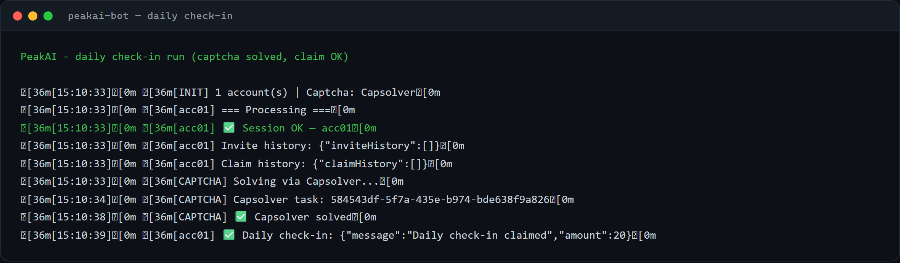

# PEAKAI Bot — Daily Check-in Automation

Automated daily check-in for PeakAI Genesis Incentive (Stage 1).
Earn Genesis points → claim USDC (1,500 Genesis = 1 USDC).

## Bukti run (dari bot sendiri, bukan mockup)



Dirender dari `logs/peakai.log`: sesi valid, Capsolver menyelesaikan captcha, lalu
`Daily check-in claimed` (`amount: 20`). Handle akun di-mask jadi `acc01`.

Catatan: pada run terakhir setelah itu log menulis `Session invalid — re-login needed`, jadi kartu
ini adalah check-in terakhir yang sukses. Login ulang di browser lalu perbarui cookie di `config.json`.

## What is PeakAI?

AI-powered content creator platform. Seed round $2M (ViaBTC Capital).
Airdrop CONFIRMED on CryptoRank. Genesis points = key criteria for TGE airdrop.

## Features

- ✅ Daily check-in automation (streak-based Genesis rewards)
- ✅ Multi-account support
- ✅ Cloudflare Turnstile solving (2captcha or manual)
- ✅ Session management (cookie-based auth)
- ✅ Referral tracking
- ✅ Wallet binding
- ✅ Claim history monitoring

## Requirements

| Requirement | Details |
|-------------|---------|
| Node.js | v18+ |
| Twitter/TikTok account | For PeakAI login |
| 2captcha API key | Optional — for auto captcha solving ($3/1000 solves) |
| Browser (Chrome) | For initial cookie extraction |

## Setup

### 1. Install dependencies

```bash
cd ~/LYID-BOTS/peakai-bot
npm install
```

### 2. Login & Extract Cookie

1. Open Chrome → go to `https://www.takeapeak.ai/genesis`
2. Click **Login** → Sign in with Twitter or TikTok
3. Complete onboarding: Connect X → Follow @TakeAPeakAI → Connect Wallet
4. Press **F12** → Application tab → Cookies → `www.takeapeak.ai`
5. Copy ALL cookie values (especially `better-auth.session_token` or similar)
6. Paste into `config.json` → `accounts[0].cookie`

### 3. Configure config.json

```json
{
  "accounts": [
    {
      "name": "my_account",
      "cookie": "better-auth.session_token=xxxxx; other=values",
      "userId": "",
      "referralCode": ""
    }
  ],
  "captcha": {
    "provider": "2captcha",
    "twocaptcha_api_key": "YOUR_2CAPTCHA_KEY"
  },
  "settings": {
    "delay_between_accounts_sec": 5,
    "retry_on_fail": 3
  }
}
```

**Captcha options:**
- `"provider": "manual"` — skip auto-solve, check-in may fail without token
- `"provider": "2captcha"` — auto-solve Turnstile ($0.003/solve)

### 4. Run

```bash
node index.js
```

## Referral System

- Referral link: `https://takeapeak.ai/invite/{user_id}`
- Earn 5% of referral's weekly Genesis
- Earn 30-200 Genesis per activated referral (AI-scored by X account quality)
- Referral activation requires: login + follow @TakeAPeakAI + connect wallet

## Genesis Rewards

| Streak Day | Genesis Earned |
|------------|---------------|
| Day 1 | 13 |
| Day 2 | 15 |
| Day 3 | 20 |
| Day 4 | 25 |
| Day 5 | 35 |
| Day 6 | 45 |
| Day 7+ | 65 |

⚠️ Missing 1 day = streak resets to Day 1!

## USDC Conversion

- Rate: 1,500 Genesis = 1 USDC
- Min withdrawal: 1 USDC
- Weekly bonus: 100-300 USDC for Top 50 earners
- Pool: 5,000 USDC total (first-come first-served)

## Cron Schedule

```bash
# Run daily at 00:05 UTC (after midnight reset)
5 0 * * * cd ~/LYID-BOTS/peakai-bot && node index.js >> logs/daily.log 2>&1
```

## Troubleshooting

| Issue | Fix |
|-------|-----|
| Session expired | Re-login in browser, extract new cookie |
| Captcha failed | Check 2captcha balance or switch to manual |
| Check-in 400 | Already checked in today, or session invalid |
| 401 on all endpoints | Cookie expired, re-extract from browser |

## API Reference (from reverse engineering)

| Endpoint | Method | Auth | Description |
|----------|--------|------|-------------|
| `/api/auth/get-session` | GET | Cookie | Check session validity |
| `/api/points` | POST | Cookie | Daily check-in `{actionType:"DAILY_CHECK_IN",token}` |
| `/api/genesis-invite-history` | GET | Cookie | Referral stats |
| `/api/genesis-claim-history` | GET | Cookie | USDC claim history |
| `/api/bindWallet` | POST | Cookie | Bind wallet `{walletAddress}` |

Auth: better-auth session cookie (HttpOnly)
Captcha: Cloudflare Turnstile sitekey `0x4AAAAAACyER7nGDFnRwQCo`

## 💰 Harga

| Lisensi | Harga | Fitur |
|---------|-------|-------|
| **Single** | Rp 120.000 / ~$8 | 1 device, lifetime |
| **Bundle (3 bot)** | Rp 250.000 / ~$16 | Pilih 3 bot, hemat 20% |
| **Pro (semua bot)** | Rp 1.100.000 / ~$70 | Semua bot + update, hemat 30% |

**Cara beli:** Chat [@OG_LYID_bot](https://t.me/OG_LYID_bot) di Telegram → /buy

**Bayar pakai:**
- 🇮🇩 DANA / GoPay / ShopeePay / BCA / Seabank
- 🌐 Crypto (USDT/SOL/ETH)

## 🔧 Troubleshooting

| Masalah | Solusi |
|---------|--------|
| `Cannot find module` | Jalankan `npm install` di folder bot |
| `insufficient balance` | Pastikan wallet punya cukup token untuk gas |
| `429 Too Many Requests` | Tunggu 30-60 detik, bot auto-retry |
| Proxy error | Cek `proxy.txt` — pastikan proxy aktif |
| Bot diam/tidak jalan | Cek `config.json` — pastikan API key valid |
| License invalid | Chat [@OG_LYID_bot](https://t.me/OG_LYID_bot) → /verify |

**Butuh bantuan?** Join [Discord](https://discord.gg/ZK2NVkfSNn) atau chat [@layerairdrop](https://t.me/layerairdrop)
